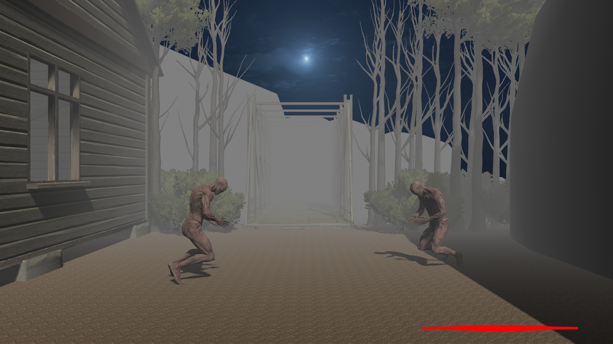
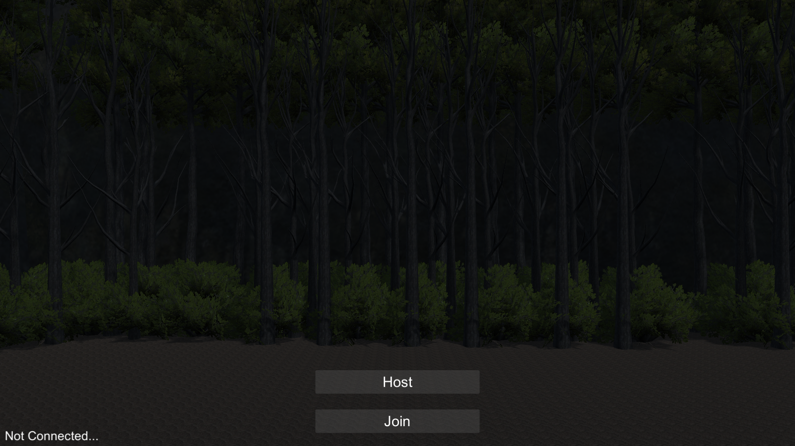
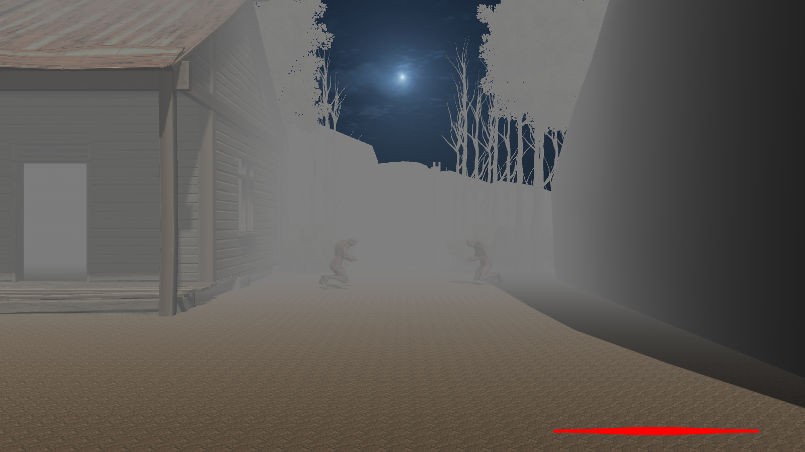

# Rundown

A first-person **online co-op survival horror** prototype built in Unity. Players move through a dungeon to complete objectives while avoiding monsters that hunt by **sound**. Every footstep, gunshot or tool you use makes noise, and a sleeping monster that hears too much wakes up and attacks.

> Final-year Industry Work Project (IWP), Nanyang Polytechnic, 2021. Solo project.



| | |
|---|---|
|  |  |

## Highlights

- **Sound-driven enemy AI.** An `AudioManager` sends sound events (position, type, playing or stopped) to every `ListenerEntity`. Enemies such as `SleeperLogic` build up "awareness" from nearby sounds and switch to a hostile state through Animator `StateMachineBehaviour`s (`SceneLinkedSMB`, `HostileState`).
- **On-screen sound graph.** A UI graph (`SoundGraph`, `ProcessSound`) shows players how much noise they are making.
- **Networked multiplayer.** Built on [Mirror](https://mirror-networking.com/) with a custom `NetManager`. [ParrelSync](https://github.com/VeriorPies/ParrelSync) was used to test several clients on one machine.
- **Player classes and weapons**, using Unity's new Input System and Cinemachine.

## Tech

| | |
|---|---|
| Engine | Unity 2020.3.23f1 (LTS) |
| Language | C# |
| Networking | Mirror |
| Other | Cinemachine, Input System, TextMeshPro, ParrelSync |

## Project structure

```
Assets/
  GameplayScripts/
    Entities/      player logic, player classes, enemy AI and state machine behaviours
    General/       audio manager, sound listeners, event system
    Networking/    Mirror NetworkManager
    UI/            sound graph
    Weapons/
  GameObjects/     prefabs (player, enemy, UI)
  Scenes/
```

## Running it

1. Open the project folder in **Unity Hub** with Unity **2020.3.23f1**. The first import regenerates `Library/` and may take a few minutes.
2. Open `Assets/Scenes/SampleScene.unity` and press Play.
3. To test multiplayer locally, use **ParrelSync → Clones Manager** to open a second editor. Host on one editor and join from the other.

## Credits

- Character model and animations: [Mixamo](https://www.mixamo.com/)
- Networking: [Mirror](https://github.com/MirrorNetworking/Mirror) (MIT)
- Local multiplayer testing: [ParrelSync](https://github.com/VeriorPies/ParrelSync) (MIT)
- Inspired by *GTFO* and *Phasmophobia*.

The copyrighted music used as a test sound during development has been replaced with an original, procedurally generated tone (`Assets/Audio/TestNoise.wav`). The sound-detection mechanic works the same way.
